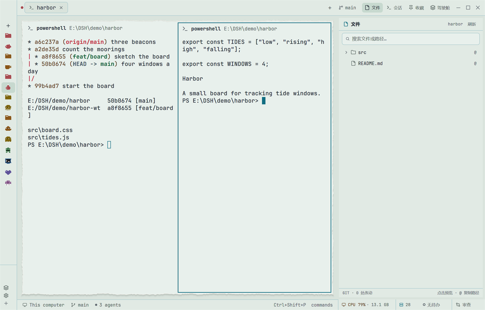

# Oh My Herdr

**Less terminal scrolling. More time with the results.** Oh My Herdr is a Chinese-language workspace layout for the [Herdr desktop app](https://herdr.dev/). Keep your terminals and spaces, with project navigation, session recovery, replies and code review within reach.

[简体中文](README.md) · Install scripts: [Windows](install.ps1) · [macOS / Linux](install.sh)

## What changes from Herdr’s default layout?

| When you want to… | Default Herdr | Oh My Herdr |
| --- | --- | --- |
| Switch between projects | Navigate the machine and space list | Browse spaces grouped by folder and expand them to see terminals. Space colours carry through the sidebar, tabs and panes. Collapse the sidebar to an icon rail when you need the room. |
| See who needs you | Check agent status in the sidebar and tabs | Scan separate waiting, running and done groups. Click a waiting agent to go straight to its terminal. |
| Find a file without leaving the terminal | Use the built-in files and changes panels | Open one drawer for files, sessions and favourites. Search and preview files, then copy an `@relative/path` reference in one click. |
| Recognise the current pane at a glance | Use the default pane header and theme | See the program, folder and status in each pane header. Qingci and Xuanmo follow the system’s light and dark modes; the optional [paper theme](screenshot-paper.png) adds torn edges and highlighter selection. |

## New workflows, not just a new look

- **Find an earlier reply without scrolling.** Search OMP prompts, replies and tool calls, read by turn, and see where context was compacted. Open long replies in a larger reader or jump back to a turn that’s still in terminal scrollback. This history panel currently supports local OMP sessions on Windows only.
- **Resume different agents’ sessions from one place.** Search and filter sessions from OMP, Codex, Claude Code, CodeBuddy, Pi, project archives and optional OpenCode (requires `sqlite3`), including on connected machines. Focus a session that’s already open, or resume a supported past session directly or by copying its resume command.
- **Review the files your agent just touched.** The review window reads the current Git diff and puts files identified from the latest OMP turn first. Switch between unified and side-by-side views, with staged, unstaged and untracked changes in one place.
- **Check ports and resource use without switching away.** See CPU, memory and listening ports in the status bar, or open a local service in your browser from the port list. Favourite frequently used project folders so you don’t have to browse for them again.
