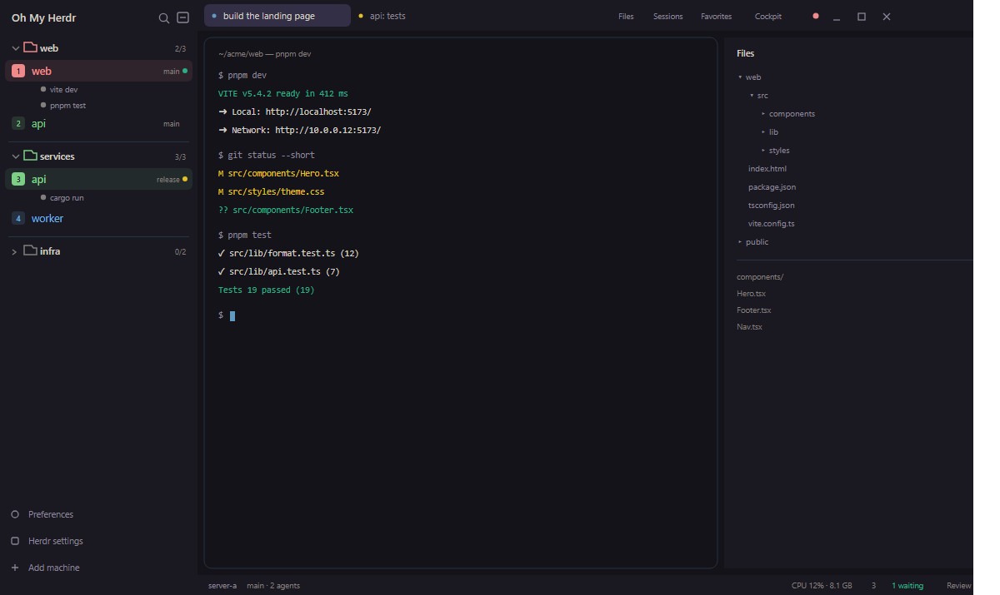

# Oh My Herdr

一个给 [Herdr](https://herdr.dev) 用的工作台布局：侧栏按目录分组、每个空间固定配色，右侧可收起的抽屉装文件与会话，底部一条状态栏常驻指标。两套主题：月白（qingci）与玄墨（xuanmo）。

英文说明见 [README.en.md](README.en.md)。




> 两张图是按布局比例画的示意图，不是截图。

---

## 改了什么

- **侧栏按目录分组**：组头（文件夹图标 + 计数 + 分隔线）、空间行、终端行三层缩进。空间带彩色数字徽章和彩色名字，颜色自动分配并记住，切主题只换明暗不换色相。
- **侧栏可折叠**：拖到 44px 变成图标轨，只剩彩色徽章；拖回来恢复。
- **顶栏重排**：标签放大到 30px 高；右侧面板按钮带中文名；左侧一个小色点标出当前空间的颜色。
- **五个抽屉页**：文件、变更、驾驶舱、会话、收藏，默认收起。会话页里已经在终端跑着的会话标「已打开」，点一下切过去，不会重新 `--resume` 把历史重放一遍。
- **状态栏**：CPU 与内存、监听端口数、等你处理的智能体数（点开名单）、审查入口。
- **终端右键直接粘贴**：不弹菜单。

## 安装

### 用脚本（Windows PowerShell）

```powershell
.\install.ps1 -DryRun     # 先看会写什么
.\install.ps1             # 不覆盖已有文件；keys.json 只加缺的键，冲突只报不改
```

### 用脚本（macOS / Linux / WSL）

```sh
./install.sh --dry-run    # 先看会写什么
./install.sh              # 不覆盖已有文件；--force 覆盖
./install.sh --target=DIR # 装到别的配置目录
```

`install.sh` 合并 `keys.json` 需要一个能用的 `python3`（或 `python`）；都没有时它会把要加的键直接打印出来，你手动加。

### 多台电脑

同一个仓库装到第二台机器：clone 下来跑对应脚本就行，布局、mod、主题完全一致。**不随仓库走的**有三样——空间配色与收藏（在 `shared.json`）、字体和外观（在 `settings.json`，本包不带）、以及每台机器自己的空间与会话记录（`view.json`、`~/.omp/agent/sessions`）。所以第二台机器上空间会重新分配颜色、收藏是空的，功能本身不受影响。

每台机器需要的是：Herdr 自带的 `files`/`changes`/`workspace-status` 三个 mod（安装 Herdr 就有）、`git`（显示分支）、`omp` 在 PATH（只有会话抽屉需要）。

### 手动

1. `layouts/oh-my-herdr.json` → `~/.config/herdr-app/layouts/`（Windows：`C:\Users\<你>\.config\herdr-app\layouts\`）。
2. `mods/` 下每个文件夹 → 配置目录的 `mods/`。
3. `themes/qingci.json`、`themes/xuanmo.json` → 配置目录的 `themes/`。
4. `keys.json` 里的 `global` 段并进你自己的 `keys.json`（值冲突就自己挑）。
5. 切过去：

```sh
herdr-app check mods/inkstone-workbench     # 每个 mod 都值得 check 一次
herdr-app do layout.switch '{"name":"oh-my-herdr"}'
```

切回来是 `ctrl-shift-l`；不想要了就删掉这些文件。

### 依赖

Herdr 自带的 `files`、`changes`、`workspace-status` 三个 mod；`inkstone-sessions` 读 `~/.omp/agent/sessions`（没有就是空列表，不报错）；`inkstone-metrics` 读系统 CPU/内存；`inkstone-ports` 读监听端口。全部只在本机跑，不联网。

## 快捷键

| 键 | 作用 |
|---|---|
| `alt-shift-p` | 偏好（主题、外观） |
| `alt-shift-r` | 审查 |
| `alt-shift-m` | 系统指标 |
| `alt-shift-o` | 端口列表 |
| `alt-shift-i` | 待处理列表 |

## 配色

七个空间色按「用得最少的序号」分配，存的是序号不是十六进制：`shared("inkstone.spaceColors")` = `{spaceId: 0..6}`。浅色档对月白底 4.82–5.69:1，深色档对玄墨底 6.39–11.26:1。

| # | 浅色档 | 深色档 | 色相 |
|---|---|---|---|
| 0 | `#a84a50` | `#f08a8a` | 砖红 |
| 1 | `#8a5619` | `#f2a46a` | 赭橙 |
| 2 | `#7d640c` | `#e8c76a` | 芥黄 |
| 3 | `#357041` | `#7ecf86` | 竹绿 |
| 4 | `#34618f` | `#6fb3ea` | 靛蓝 |
| 5 | `#5f5399` | `#9a8ce6` | 青莲 |
| 6 | `#805083` | `#c98ae6` | 紫藤 |

调色板在 `mods/inkstone-workbench/main.js` 和 `mods/inkstone-tabs/main.js` 各存一份（mod 之间不能互相 import），改色要同时改两个文件。

## 主题

`themes/qingci.json`（月白：底 `#e8f0ec`、字 `#2b333e`、强调 `#126e82`）和 `themes/xuanmo.json`（玄墨：底 `#14131a`、字 `#d4cec4`、强调 `#619ac3`），都是完整 16 色 ANSI + 语义色槽。布局里 `theme: { "light": "qingci", "dark": "xuanmo" }`，跟随 `settings.json` 的 `appearance` 自动选。

`preview.png` / `preview-dark.png` 由 `preview.svg` + `mkprev.py` 按两个主题文件生成：

```sh
python mkprev.py    # 读 themes/*.json，重画两张预览图
```

## 限制

- 侧栏宽度、抽屉开合、折叠状态是运行态（`layouts/.state/`），重启不一定保留；布局文件里的 272/380 是初始值。
- 状态栏四块是固定宽度，改内容长度要同步改 `layouts/oh-my-herdr.json` 里的 `px`。
- 会话识别靠终端标题（omp 把会话标题写进 OSC 标题）。手动改掉标题就认不出，会当成新会话开一个；跨机器的会话不在识别范围内。
- 抽屉的「驾驶舱」页依赖 `cockpit` mod 自己的数据结构，单独拷走会退化。
- 侧栏分组按 cwd 前缀推出来，目录很深时会合并显示。

## 文件

```
layouts/oh-my-herdr.json     布局
layouts/oh-my-herdr.png      布局预览（同 preview.png）
preview.svg                  示意图源文件（两个主题共用，颜色按主题替换）
mkprev.py                    生成 preview.png / preview-dark.png
mods/inkstone-chrome         品牌条 + 底部三行（footer props）
mods/inkstone-workbench      目录/空间/终端列表，图标轨
mods/inkstone-tabs           标签栏 + 面板按钮 + 窗口按钮
mods/inkstone-sessions       omp 会话抽屉
mods/inkstone-favorites      收藏抽屉
mods/inkstone-inbox          待处理状态块 + overlay
mods/inkstone-metrics        CPU/内存块
mods/inkstone-ports          端口块
mods/inkstone-review         审查块
mods/inkstone-settings       偏好浮层
mods/inkstone-paste          终端右键直接粘贴
mods/cockpit                 驾驶舱抽屉
themes/qingci.json           月白
themes/xuanmo.json           玄墨
keys.json                    五个 alt-shift 快捷键
install.ps1 / install.sh     安装（Windows / macOS·Linux）
refresh.ps1                  反向同步（把配置目录的最新文件抓回包）
RECIPE.md                    从零重建的说明书（给你的 agent 用）
```
