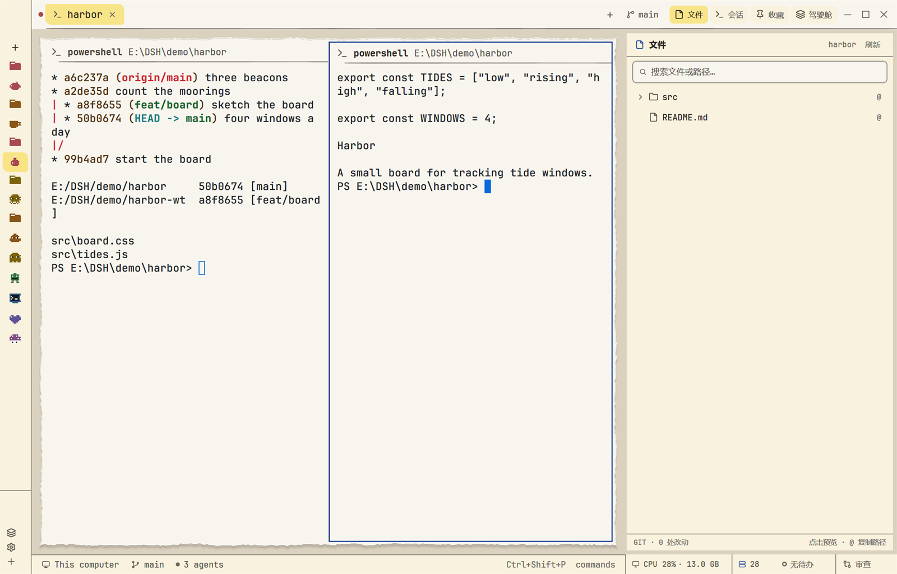

# Oh My Herdr

**Less terminal scrolling, more time with the results.** A workspace layout for the [Herdr desktop app](https://herdr.dev/): spaces grouped by folder, agents sorted by who needs you, and files, sessions and diffs in one drawer.

Herdr Desktop 0.1.16+ · Windows / macOS / Linux · MIT · [简体中文](README.zh-CN.md)


## In 30 seconds

- **Keep projects together.** Group worktrees and sub-projects by repository; bind a space to its project so a terminal's `cd` cannot move it.
- **Know who needs you.** Waiting, running and done groups take you straight to the relevant terminal.
- **Keep context nearby.** Files, past sessions and favourites share one drawer; review the current Git diff without leaving the workspace.

## Install

Launch Herdr once to create `settings.json` in its config directory. Download and extract a versioned ZIP from [Releases](https://github.com/wahaha1024/oh-my-herdr/releases), or clone this repository.

**Windows · PowerShell 5.1+**, from the extracted directory:

```powershell
.\install.ps1 -DryRun
.\install.ps1
herdr-app do layout.switch '{"name":"oh-my-herdr"}'
```

**macOS / Linux · POSIX sh**, with `python3` or `python`:

```sh
sh install.sh --dry-run
sh install.sh
herdr-app do layout.switch '{"name":"oh-my-herdr"}'
```

Existing user files are preserved by default. Preview upgrades first; `-Force` / `--force` replaces conflicting files only after backing them up. Existing program entries in `programs.json` are never overwritten, even with Force.

Config directory precedence: `-Target` / `--target` → `HERDR_APP_HOME` → `XDG_CONFIG_HOME/herdr-app` → `~/.config/herdr-app`. The older `HERDR_CONFIG` variable remains supported.

## A one-minute walkthrough

1. Select a project and expand its worktrees. To keep a space attached after a terminal changes directory, right-click it and set its project folder.
2. Click a waiting agent to return to the terminal that needs input or approval.
3. Open the file drawer and search `path:line`; switch to Sessions to resume a conversation, or open Review for the current Git diff.
4. Use Preferences at the bottom left to switch languages, reopen the guide or return to Herdr's default layout without stopping terminals.


## What changes from Herdr’s default layout?

| When you want to… | Default Herdr | Oh My Herdr |
| --- | --- | --- |
| Switch between projects | Navigate the machine and space list | Browse spaces grouped by folder and expand them to see terminals. Space colours carry through the sidebar, tabs and panes. Collapse the sidebar to an icon rail when you need the room. |
| Keep several worktrees of one repo | Each folder gets its own row, unrelated to its repository | Worktrees fold into the project's row, each with its own branch label; projects under a machine root indent one level and take a letter avatar |
| Have a session `cd` away | Spaces follow the live directory | Right-click the space and set its project folder once; it stops moving |
| See who needs you | Check agent status in the sidebar and tabs | Scan separate waiting, running and done groups. Click a waiting agent to go straight to its terminal. |
| Find a file without leaving the terminal | Use the built-in files and changes panels | Open one drawer for files, sessions and favourites. Search and preview files, then copy an `@relative/path` reference in one click. |
| Recognise the current pane at a glance | Use the default pane header and theme | See the program, folder and status in each pane header. Qingci and Xuanmo follow the system’s light and dark modes; the optional [paper theme](screenshot-paper.png) adds torn edges and highlighter selection. |
| Work in English or Chinese | English only | Pick either language in the preferences page; the sidebar, tabs, drawer, right-click menus and every setting follow |

## New workflows, not just a new look

- **Find an earlier reply without scrolling.** Search local OMP prompts, replies and tool calls by turn, see compaction points, open long replies in a larger reader and jump to available terminal scrollback. Windows uses Node with a PowerShell fallback; macOS/Linux use Node or the shell parser. Remote history is not supported.
- **Resume different agents’ sessions from one place.** Search and filter sessions from OMP, Codex, Claude Code, CodeBuddy, Pi, project archives and optional OpenCode (requires `sqlite3`), including on connected machines. Focus a session that’s already open, or resume a supported past session directly or by copying its resume command.
- **Review the files your agent just touched.** The review window reads the current Git diff and puts files identified from the latest OMP turn first. Switch between unified and side-by-side views, with staged, unstaged and untracked changes in one place.
- **One project, one entry — sessions stay put.** Worktrees and sub-projects group by their Git origin; a machine can hold a root folder you right-click to create spaces in, with everything under it indented one level. Bind a space to a project and a `cd` in its terminal no longer drags it out of the group.
- **Run a session from one right-click.** Pin it, put it away, move it left or right, open a tab beside it, split right or down, zoom, peek, or open its folder. A running session offers *Interrupt*; a stopped one offers *Compact* instead. Slash commands — `/fork`, `/tree`, `/cost`, `/export` and the rest — sit in *More commands…*, so you don't have to remember them.
- **Read the tab strip as a status board.** Waiting is a red square, running an amber ring, done a green dot — the same palette as the agents panel, and the tab's tint follows it.
- **Jump to a line, not just a file.** Type `path:line` in the drawer's search box to land on that line, `↑` for the parent folder and `⌂` back to the project.
- **Switch between Chinese and English in one click.** Pick a language at the top of the preferences page and the sidebar, tabs, drawer, right-click menus and settings change together. The choice lives in `shared`, so it survives a restart.
- **Check ports and resource use without switching away.** See CPU, memory and listening ports in the status bar, or open a local service in your browser from the port list. Favourite frequently used project folders so you don’t have to browse for them again.

## Themes

Qingci follows the system’s light mode and Xuanmo its dark mode; both ship with the layout. The optional [Zhi paper theme](screenshot-paper.png) adds torn paper edges and highlighter selection.




## Capabilities and boundaries

| Feature | Windows | macOS / Linux | Connected machines |
| --- | --- | --- | --- |
| Layout, grouping, themes and bilingual UI | Supported | Supported | Local app renders the UI |
| Session discovery and resume | Supported | Supported | Requires the relevant CLI on that machine |
| OMP turn history and reader | Node; PowerShell fallback | Node; shell fallback | Unavailable; use Sessions to resume |
| OpenCode sessions | Requires `sqlite3` | Requires `sqlite3` | Install `sqlite3` on the session host |
| CodeBuddy program icon | Supported | Supported | Uses the viewing app's local program table |
| Agent working / done status | Requires OSC 7501 reports | Requires OSC 7501 reports | CodeBuddy currently does not report this status |

## Upgrade, restore and uninstall

Installation records live in `<config>/.omh/install.json`; backups live in `<config>/.omh/backups/<backup-id>/`. Keep them for recovery.

| Action | Windows | macOS / Linux |
| --- | --- | --- |
| Preview upgrade | `.\install.ps1 -Force -DryRun` | `sh install.sh --force --dry-run` |
| Upgrade with backup | `.\install.ps1 -Force` | `sh install.sh --force` |
| Restore a backup | `.\install.ps1 -Restore <backup-id>` | `sh install.sh --restore <backup-id>` |
| Uninstall | `.\install.ps1 -Uninstall` | `sh install.sh --uninstall` |

Before uninstalling, switch to the default layout: `herdr-app do layout.switch '{"name":"main"}'`. Uninstall acts only on recorded files that still match their installed hashes; user-modified files and unrelated settings stay. All three themes—Qingci, Xuanmo and Zhi—are tracked, rather than deleted with a wildcard. Restore also preserves later user edits. Add `-DryRun` / `--dry-run` to preview either operation.

## Diagnostics and releases

With Python 3 available, preview `python scripts/diagnose.py` before sharing its output. It reports versions, tool availability and redacted load-error summaries—not sessions or environment values. Use `--output diagnosis.txt` only when you want a file. Diagnostic and development scripts are available in the source checkout.

Maintainers: run `python scripts/check.py`, `python tests/test_install.py`, then `python scripts/release.py` and `python scripts/release.py --check`. The three-platform CI checks changes; a `v` tag matching `VERSION` publishes the versioned ZIP and `SHA256SUMS`. See [CHANGELOG](CHANGELOG.md).

## License

MIT
