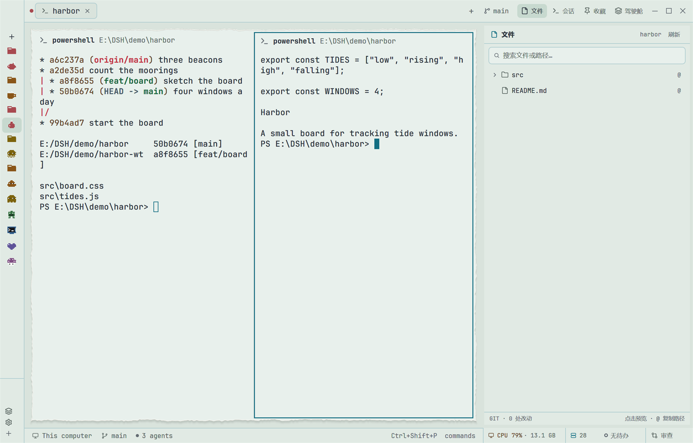

# Oh My Herdr
**少翻终端，多看结果。** Oh My Herdr 是一套给 [Herdr 桌面版](https://herdr.dev/) 用的中文工作台布局。保留熟悉的终端和空间，把找项目、续会话、读回复、审改动放到手边。

[English](README.en.md) · 安装脚本：[Windows](install.ps1) · [macOS / Linux](install.sh)

## 和 Herdr 默认布局比，日常操作哪里更顺手？
| 你想做什么 | Herdr 默认布局 | Oh My Herdr |
| --- | --- | --- |
| 在多个项目间切换 | 从机器与空间列表进入终端 | 空间按目录归组，展开就能看到终端；同一空间的配色贯穿侧栏、标签和窗格，侧栏还能收成图标轨 |
| 找出现在该处理谁 | 在侧栏和标签上看智能体状态 | 左侧独立列出待处理、运行中、已完成；点待处理项直接回到对应终端 |
| 边看终端边找文件 | 使用内置文件和变更面板 | 中文抽屉按需展开，可切换文件、会话和收藏；文件支持搜索、只读预览和一键复制 `@相对路径` |
| 一眼认出当前窗格 | 使用默认窗格头和主题 | 窗格头直接显示程序、目录和状态；月白、玄墨随系统明暗切换，也可换成带撕纸边和荧光笔选中效果的[纸墨主题](screenshot-paper.png) |

## 不只是换主题：新增的工作流
+ **想找上一轮的回答？直接搜，不用往上翻。** OMP「历史发言」可搜索提问、回复和工具调用，按轮查看，并标出上下文压缩点。长回复可以在大窗口里读；只要那一轮还在终端回滚区，就能跳回原位。历史面板目前仅支持 Windows 上的本地 OMP 会话。
+ **不同智能体的旧会话，从同一个入口续聊。** 会话页汇总 OMP、Codex、Claude Code、CodeBuddy、Pi、项目归档以及可选的 OpenCode（需 `sqlite3`）。可按关键词和来源筛选，也可扫描已连接机器的会话。已经打开的就切回原终端，可恢复的旧会话直接续开或复制恢复命令。
+ **先审智能体这一轮碰过的文件。** 「审查」窗口读取当前 Git 改动，把从 OMP 本轮日志识别到的改动文件置顶。支持统一视图和左右对照，暂存区、工作区与未跟踪文件都能看。
+ **不用切出去查端口和资源。** 底栏直接看 CPU、内存和监听端口；点开端口列表，可以在浏览器打开本地服务。常用项目目录也能收藏，不必每次从侧栏重新找。

