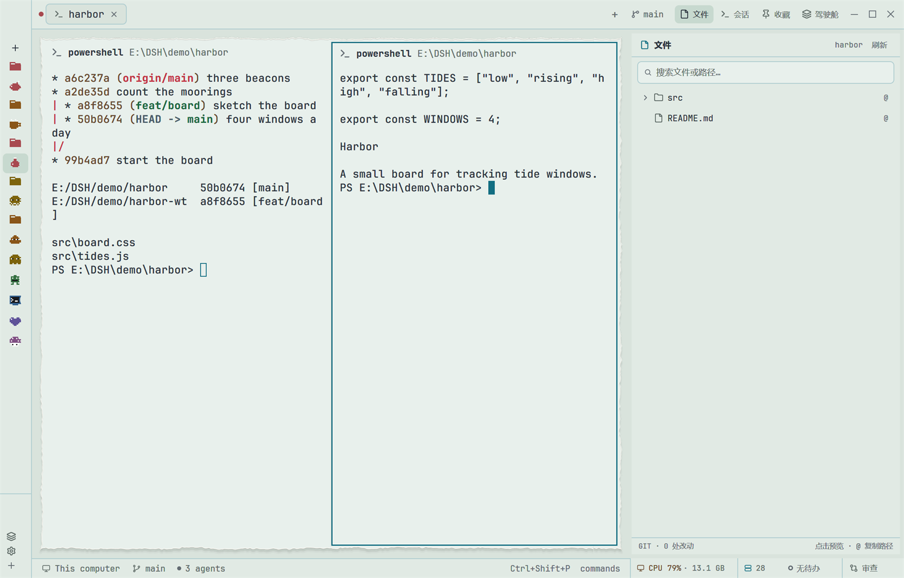
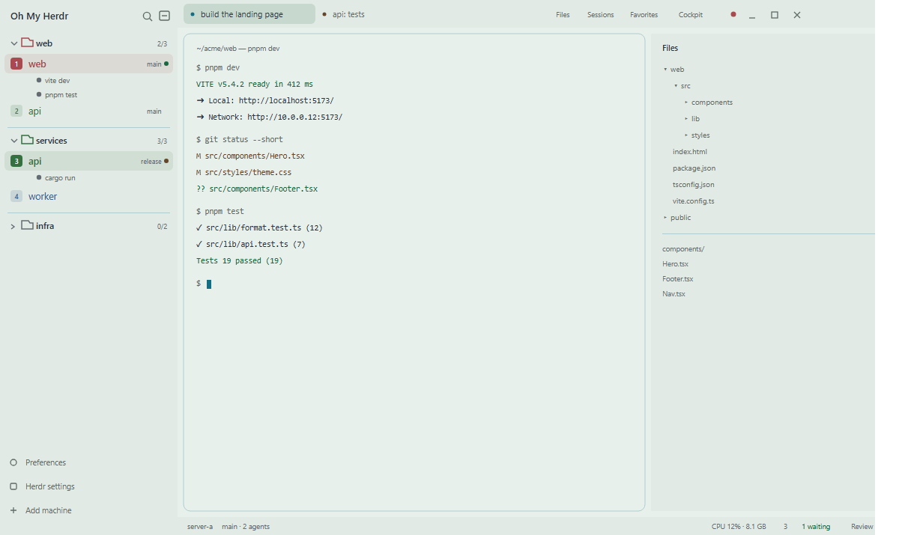
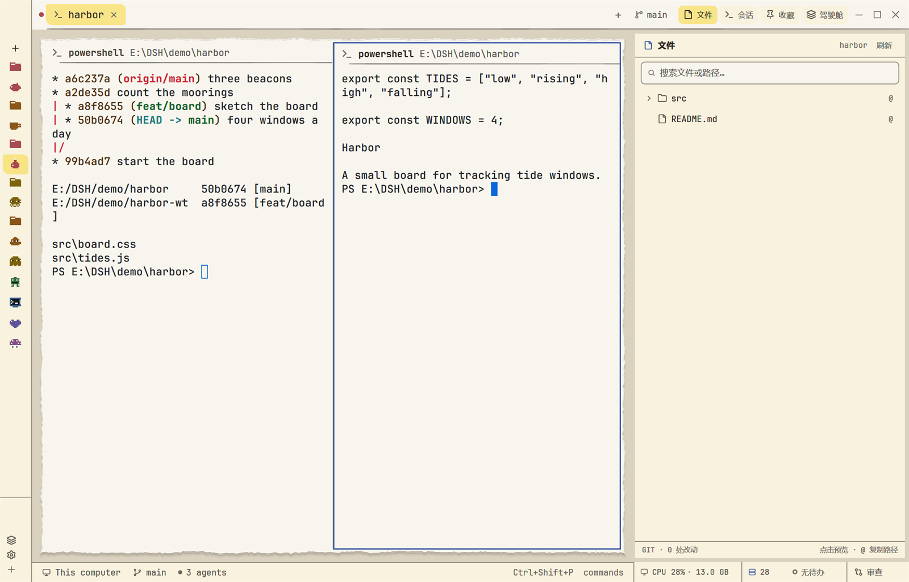

# Oh My Herdr
**少翻终端，多看结果。** Oh My Herdr 是一套给 [Herdr 桌面版](https://herdr.dev/) 用的中文工作台布局：空间按目录归组，智能体按谁在等你排序，文件、会话和改动收在一个抽屉里。

Herdr 桌面版 0.1.16+ · Windows / macOS / Linux · MIT · [English](README.md) · 简体中文



## 30 秒了解

- **项目不散。** 工作树与子项目按仓库归组，空间绑定目录后不会跟着终端 `cd` 跑走。
- **待办不漏。** 待处理、运行中、已完成分组；点待处理项直接回到终端。
- **上下文不断。** 一个抽屉切换文件、旧会话与收藏；审查窗口看实时 Git 改动。

## 安装

先启动一次 Herdr，生成配置目录中的 `settings.json`。下载 [Release](https://github.com/wahaha1024/oh-my-herdr/releases) 的版本化 ZIP 并解压，或克隆仓库。

**Windows · PowerShell 5.1+**（在解压目录执行）：

```powershell
.\install.ps1 -DryRun
.\install.ps1
herdr-app do layout.switch '{"name":"oh-my-herdr"}'
```

**macOS / Linux · POSIX sh**（需 `python3` 或 `python`）：

```sh
sh install.sh --dry-run
sh install.sh
herdr-app do layout.switch '{"name":"oh-my-herdr"}'
```

默认不覆盖用户已有文件；升级前先预览，加 `-Force` / `--force` 才覆盖冲突文件，并在写入前备份。`programs.json` 的已有程序条目始终保留，Force 也不覆盖。

配置目录优先级：`-Target` / `--target` → `HERDR_APP_HOME` → `XDG_CONFIG_HOME/herdr-app` → `~/.config/herdr-app`。旧的 `HERDR_CONFIG` 保留兼容。

## 一分钟上手

1. 在左侧点项目，展开工作树；终端换目录后仍想固定归属时，右键空间「设置归属目录」。
2. 点「待处理」智能体，立即回到需要输入或确认的终端。
3. 打开文件抽屉，搜索 `路径:行号`；切到「会话」恢复旧对话，打开「审查」看当前 Git 改动。
4. 左下角「偏好」切换中英文、重看使用提示或恢复 Herdr 默认布局；这些操作不终止终端。



## 和 Herdr 默认布局比，日常操作哪里更顺手？
| 你想做什么 | Herdr 默认布局 | Oh My Herdr |
| --- | --- | --- |
| 在多个项目间切换 | 从机器与空间列表进入终端 | 空间按目录归组，展开就能看到终端；同一空间的配色贯穿侧栏、标签和窗格，侧栏还能收成图标轨 |
| 同一项目开好几个工作树 | 每个目录各占一行，看不出属于同一个仓库 | 工作树归到主项目一行，各自带分支标签；子项目按根目录缩进一级并换成字母头像 |
| 会话 `cd` 到别处后侧栏就把它挪走 | 空间跟着实时目录归组 | 右键空间「设置归属目录」，绑一次就固定归到那个项目下 |
| 找出现在该处理谁 | 在侧栏和标签上看智能体状态 | 左侧独立列出待处理、运行中、已完成；点待处理项直接回到对应终端 |
| 边看终端边找文件 | 使用内置文件和变更面板 | 中文抽屉按需展开，可切换文件、会话和收藏；文件支持搜索、只读预览和一键复制 `@相对路径` |
| 一眼认出当前窗格 | 使用默认窗格头和主题 | 窗格头直接显示程序、目录和状态；月白、玄墨随系统明暗切换，也可换成带撕纸边和荧光笔选中效果的[纸墨主题](screenshot-paper.png) |
| 换界面语言 | 只有英文 | 偏好页一键在中文与 English 之间切换，侧栏、标签、抽屉、右键菜单和设置项一起换 |


## 不只是换主题：新增的工作流
- **想找上一轮的回答？直接搜，不用往上翻。** 本地 OMP「历史发言」支持搜索提问、回复与工具调用、按轮阅读及压缩点标记。长回复可在大窗口里读，也能跳到仍在终端回滚区的原位。Windows 优先 Node、回退 PowerShell；macOS/Linux 使用 Node 或 shell 解析。远程会话请用「会话」页恢复。
- **不同智能体的旧会话，从同一个入口续聊。** 会话页汇总 OMP、Codex、Claude Code、CodeBuddy、Pi、项目归档以及可选的 OpenCode（需 `sqlite3`）。可按关键词和来源筛选，也可扫描已连接机器的会话。已经打开的就切回原终端，可恢复的旧会话直接续开或复制恢复命令。
- **先审智能体这一轮碰过的文件。** 「审查」窗口读取当前 Git 改动，把从 OMP 本轮日志识别到的改动文件置顶。支持统一视图和左右对照，暂存区、工作区与未跟踪文件都能看。
- **一个项目一个入口，会话不会跑丢。** 工作树、子项目按 Git 归属收进同一行；机器行可以设一个根目录，右键就能在里面新建文件夹或空间，根目录下的项目自动缩进一级。会话在终端里 `cd` 到别处也不会从项目里跳出去——右键「设置归属目录」绑一次就固定。
- **一次右键管住一个会话。** 置顶、暂存、前移后移、同空间新标签、左右/向下分屏、最大化还原、快速窥视、打开所在目录。运行中的会话多一条「中断」，停下才给「压缩上下文」；`/fork`、`/tree`、`/cost`、`/export` 这些斜杠命令收在「更多命令…」里，不用记。
- **标签最左端就能看出状态。** 待处理红方块、运行中琥珀圆环、已完成绿实心，和智能体面板同一套配色；标签底色也跟着状态走，扫一眼就知道哪个在等你。
- **找文件可以直接落到某一行。** 抽屉搜索框输 `路径:行号` 回车跳到那一行，`↑` 去上级目录、`⌂` 回项目目录，每个文件按类型给图标。
- **中文或英文，一键切换。** 偏好页顶部选语言，侧栏、标签、抽屉、右键菜单和设置项同时换；选择存在 `shared` 里，重启后仍然记得。
- **不用切出去查端口和资源。** 底栏直接看 CPU、内存和监听端口；点开端口列表，可以在浏览器打开本地服务。常用项目目录也能收藏，不必每次从侧栏重新找。

## 主题

月白跟随系统浅色、玄墨跟随深色，随布局一起安装。可选的[纸墨主题](screenshot-paper.png)会在窗格四周加撕纸边，选中文字用荧光笔效果。



## 能力与边界

| 功能 | Windows | macOS / Linux | 已连接的远程机器 |
| --- | --- | --- | --- |
| 布局、归组、主题、中英界面 | 支持 | 支持 | 界面由本地 app 绘制 |
| 会话发现与恢复 | 支持 | 支持 | 对应智能体 CLI 需安装在那台机器 |
| OMP 历史发言与阅读窗口 | Node；PowerShell 回退 | Node；shell 回退 | 不支持；用「会话」页恢复 |
| OpenCode 会话 | 需要 `sqlite3` | 需要 `sqlite3` | `sqlite3` 装在会话所在机器 |
| CodeBuddy 程序图标 | 支持 | 支持 | 使用查看端 app 的本地程序表 |
| 智能体运行／完成状态 | 需要程序报告 OSC 7501 | 需要程序报告 OSC 7501 | CodeBuddy 目前不报告该状态 |

## 升级、恢复与卸载

安装登记保存在 `<配置目录>/.omh/install.json`，备份在 `<配置目录>/.omh/backups/<backup-id>/`；请保留这些文件用于恢复。

| 操作 | Windows | macOS / Linux |
| --- | --- | --- |
| 预览升级 | `.\install.ps1 -Force -DryRun` | `sh install.sh --force --dry-run` |
| 备份后升级 | `.\install.ps1 -Force` | `sh install.sh --force` |
| 恢复指定备份 | `.\install.ps1 -Restore <backup-id>` | `sh install.sh --restore <backup-id>` |
| 卸载 | `.\install.ps1 -Uninstall` | `sh install.sh --uninstall` |

卸载前先切回默认布局：`herdr-app do layout.switch '{"name":"main"}'`。卸载只处理已登记且内容仍与安装哈希一致的文件，用户改过的文件与其他配置会保留；青瓷、玄墨、纸墨三个主题全部按登记处理，不用通配符误删。恢复也会保留后续用户修改。两种操作均可加 `-DryRun` / `--dry-run` 预览。

## 诊断与发布

安装 Python 3 后，先运行 `python scripts/diagnose.py` 预览，再决定是否分享。输出只含版本、工具可用性和脱敏加载错误摘要，不采集会话或环境变量值；只有加 `--output diagnosis.txt` 才写文件。诊断及开发脚本从源码仓库运行。

维护者运行 `python scripts/check.py`、`python tests/test_install.py`，再用 `python scripts/release.py` 打包、`python scripts/release.py --check` 核对。三平台持续集成检查变更；推送与 `VERSION` 一致的 `v` 标签才发布版本化 ZIP 与 `SHA256SUMS`。变更记录见 [CHANGELOG](CHANGELOG.md)。

## 许可证

MIT

